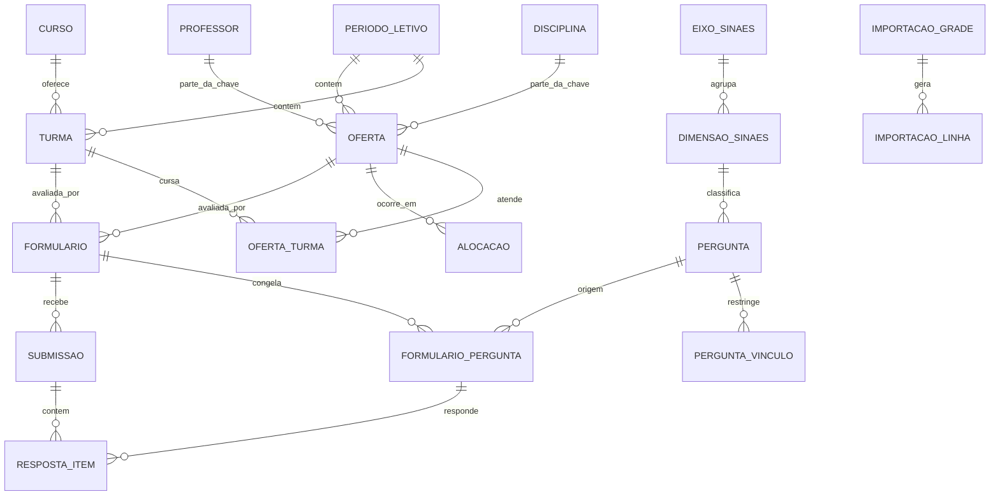

# 02 — Modelo de Domínio

PostgreSQL (Supabase) · SQLAlchemy 2.x declarativo tipado + asyncpg · Alembic.

## Diagrama de entidades



## Enums

```python
class Turno(str, Enum):            MATUTINO="MATUTINO"; NOTURNO="NOTURNO"
class Segmento(str, Enum):         DISCENTE="DISCENTE"; DOCENTE="DOCENTE"; TECNICO_ADMINISTRATIVO="TECNICO_ADMINISTRATIVO"; COMUNIDADE="COMUNIDADE"
class TipoInstrumento(str, Enum):  DISCENTE_TURMA="DISCENTE_TURMA"; DOCENTE="DOCENTE"; TECNICO_ADMINISTRATIVO="TECNICO_ADMINISTRATIVO"; COMUNIDADE="COMUNIDADE"
class BlocoPergunta(str, Enum):    DISCIPLINA="DISCIPLINA"; PROFESSOR="PROFESSOR"; INSTITUCIONAL="INSTITUCIONAL"
class AplicacaoPergunta(str, Enum):TODAS="TODAS"; ESPECIFICA="ESPECIFICA"
class TipoPergunta(str, Enum):     LIKERT_5="LIKERT_5"; SIM_NAO="SIM_NAO"; TEXTO_LIVRE="TEXTO_LIVRE"; MULTIPLA_ESCOLHA_UNICA="MULTIPLA_ESCOLHA_UNICA"
class Modalidade(str, Enum):       PRELECAO="PRELECAO"; PRATICA="PRATICA"; PRATICA_HOSPITALAR="PRATICA_HOSPITALAR"; EAD="EAD"; EXTENSAO="EXTENSAO"; ESTAGIO="ESTAGIO"; NAO_INFORMADA="NAO_INFORMADA"
class StatusFormulario(str, Enum): RASCUNHO="RASCUNHO"; PUBLICADO="PUBLICADO"; ENCERRADO="ENCERRADO"
class StatusImportacao(str, Enum): PROCESSANDO="PROCESSANDO"; AGUARDANDO_REVISAO="AGUARDANDO_REVISAO"; APLICADA="APLICADA"; CANCELADA="CANCELADA"
class StatusLinha(str, Enum):      OK="OK"; REVISAR="REVISAR"; ERRO="ERRO"; IGNORADA="IGNORADA"
class TipoAlvo(str, Enum):         DISCIPLINA="DISCIPLINA"; PROFESSOR="PROFESSOR"; CURSO="CURSO"
```

Relação fixa `TipoInstrumento → Segmento` (constante no código, não tabela):

```python
SEGMENTO_DO_INSTRUMENTO = {
    DISCENTE_TURMA: DISCENTE, DOCENTE: DOCENTE,
    TECNICO_ADMINISTRATIVO: TECNICO_ADMINISTRATIVO, COMUNIDADE: COMUNIDADE,
}
```

---

## Tabelas

### `periodo_letivo`
`id` · `codigo` varchar(10) **UNIQUE** (`2026.2`) · `ano` int · `semestre` smallint ·
`ativo` bool (apenas um) · timestamps.

### `curso`
`id` · `nome` varchar(120) · `slug` varchar(60) **UNIQUE** · `ativo`.
Seed: **`BIOMEDICINA`, `ENFERMAGEM`, `EDUCACAO_FISICA`, `GTI`** — e só.

> ⚠️ **Não crie um curso `CICLO_BASICO`.** As abas de ciclo básico são grade
> compartilhada entre cursos reais; suas colunas se expandem nas turmas dos cursos que a
> instrução de matrícula declara (RN-03).

### `professor`
| Campo | Tipo | Regra |
|---|---|---|
| `id` | PK int | |
| `nome_exibicao` | varchar(120) NOT NULL | primeiro nome da planilha: `Washington` |
| `nome_completo` | varchar(200) NULL | preenchido pelo admin; exigido antes do relatório oficial |
| `slug` | varchar(120) **UNIQUE** | normalizado |
| `email` | varchar(160) NULL | |
| `ativo` | bool | |

### `disciplina`
`id` · `nome` varchar(240) · `slug` varchar(240) **UNIQUE** · `curso_id` FK NULL
(`NULL` = interdisciplinar/ciclo básico) · `ativo`.

### `professor_alias` / `disciplina_alias`
Grafias já conciliadas — é o que faz a importação melhorar a cada semestre.
`id` · `professor_id`/`disciplina_id` FK · `texto_origem` varchar(240) ·
`slug_origem` varchar(240) **UNIQUE**.

Seed a partir do Anexo A: `washignton→Washington`, `vitoria→Victória`,
`cinnesiologia e biomecanica→Cinesiologia e Biomecânica`,
`promocao a saude→Promoção da Saúde`,
`gestao de projetos em tecnologia de informacao→…da Informação`.

### `turma` — ⭐ **17 registros em 2026.2**
| Campo | Tipo | Regra |
|---|---|---|
| `id` | PK int | |
| `periodo_letivo_id` | FK NOT NULL | **chave** |
| `curso_id` | FK NOT NULL | **chave** |
| `turno` | enum `Turno` NOT NULL | **chave** |
| `periodo_numero` | smallint NOT NULL | **chave** — `2`, `4`, `6`, `8` |
| `modulo` | varchar(120) NULL | `AB`, `Análises Biomédicas` — **informativo, fora da chave** |
| `rotulos_origem` | jsonb NULL | `["Turma A","Turma B"]` — o que a planilha dizia |
| `total_alunos` | int NULL | opcional, só para calcular adesão |
| `abas_origem` | jsonb NULL | abas que alimentaram esta turma |
| `colunas_origem` | jsonb NULL | `["Biomedicina Noturno!D","Biomedicina Noturno!E"]` — rastreabilidade |
| `compartilhada_ciclo_basico` | bool default false | veio de aba de ciclo básico (RN-03) |
| `observacao` | text NULL | |
| `ativo` | bool | |

```sql
UNIQUE (periodo_letivo_id, curso_id, turno, periodo_numero)   -- RN-04
```

> ⚠️ **`modulo` e `rotulo` NÃO fazem parte da chave.** *Biomedicina · Noturno · 4º
> período* é **uma** turma, mesmo aparecendo como `Turma A` em duas colunas e como
> `Sub - Turma A`/`Sub - Turma B` em outra aba. Incluí-los na chave inflaria 17 turmas
> para 21 e entregaria dois formulários institucionais aos mesmos alunos.
> Por isso `rotulos_origem` e `colunas_origem` são **listas**.

### `oferta` — ⭐ **a unidade avaliada — 105 registros em 2026.2**
| Campo | Tipo | Regra |
|---|---|---|
| `id` | PK int | |
| `periodo_letivo_id` | FK NOT NULL | |
| `disciplina_id` | FK NOT NULL | |
| `professor_id` | FK NOT NULL | |
| `avaliavel` | bool default `true` | RN-15 |
| `observacao` | text NULL | |
| `ativo` | bool | |

```sql
UNIQUE (periodo_letivo_id, disciplina_id, professor_id)   -- RN-09
```

> ⚠️ **`turma_id` NÃO existe nesta tabela.** Incluí-lo transformaria as 105 ofertas em
> 136. A relação com turma é N:N, na tabela abaixo.

### `oferta_turma` — quais turmas cursam a oferta (RN-07)
`id` · `oferta_id` FK NOT NULL · `turma_id` FK NOT NULL ·
`UNIQUE (oferta_id, turma_id)`.
Em 2026.2: **27 das 105 ofertas** têm mais de uma linha aqui; **4 não têm nenhuma**
(vindas da coluna de estágio) e por isso não geram formulário (RN-30).

### `alocacao` — a grade horária (auditoria; não usada na avaliação)
`id` · `oferta_id` FK · `turma_id` FK · `dia_semana` smallint (1=Seg…6=Sáb) ·
`horario_rotulo` varchar(40) · `horario_inicio` time NULL ·
`duracao_horarios` smallint default 1 · `modalidade` enum ·
`aba_origem` varchar(80) · `celula_origem` varchar(12) (`D19`) ·
`texto_origem` text **sempre preenchido** (RN-11).

### `eixo_sinaes` / `dimensao_sinaes` — **dados de referência, seed obrigatório**

`eixo_sinaes`: `id` · `numero` smallint **UNIQUE** (1–5) · `nome` varchar(120).

`dimensao_sinaes`:
| Campo | Tipo | Regra |
|---|---|---|
| `id` | PK int | |
| `numero` | smallint **UNIQUE** | 1–10, conforme a Lei 10.861/2004 |
| `nome` | varchar(160) | nome legal da dimensão |
| `eixo_id` | FK NOT NULL | |
| `nome_institucional` | varchar(160) NULL | ⭐ como a **CPA da instituição** chama esta dimensão |
| `codigo_institucional` | varchar(40) NULL | ⭐ código usado no **Power BI histórico** |
| `descricao` | text NULL | |
| `ordem_exibicao` | int default 0 | ordem nos relatórios |
| `ativo` | bool | dimensão não aplicada neste ciclo fica inativa |

> ⭐ **`nome_institucional` e `codigo_institucional` existem para a continuidade
> histórica.** A instituição já publica um Power BI com as dimensões do ano anterior;
> se o novo sistema renomear ou renumerar as dimensões, a série histórica quebra e a
> CPA perde a comparação ano a ano — que é justamente o que o MEC espera ver.
> O relatório e a exportação CSV devem emitir **ambos** os rótulos.

Conteúdo do seed em `04_banco_de_perguntas.md` §1; alinhamento com o BI em §1.1.

### `pergunta`
| Campo | Tipo | Regra |
|---|---|---|
| `id` | PK int | |
| `texto` | text NOT NULL | |
| `codigo` | int **UNIQUE** NOT NULL | ⭐ **identidade permanente da pergunta.** 1–163 do ciclo 2024; novas a partir de 164. **Nunca renumerado, nunca reutilizado** |
| `equivalencia_id` | FK NOT NULL | ⭐ agrupa a mesma pergunta entre segmentos (67 grupos) |
| `versao_texto` | smallint default 1 | incrementa em correção de grafia; o código permanece |
| `ordem_exibicao` | int default 0 | posição no formulário — **independente** do código |
| `tipo_instrumento` | enum `TipoInstrumento` NOT NULL | em qual dos 4 instrumentos entra |
| `bloco` | enum `BlocoPergunta` NOT NULL | RN-17. `DISCIPLINA`/`PROFESSOR` ⇒ repetida por oferta |
| `dimensao_id` | FK NOT NULL | **obrigatório** — RN-16 |
| `aplicacao` | enum `AplicacaoPergunta` default `TODAS` | RN-20 |
| `tipo` | enum `TipoPergunta` default `LIKERT_5` | |
| `opcoes` | jsonb NULL | só `MULTIPLA_ESCOLHA_UNICA` |
| `obrigatoria` | bool default `true` | `TEXTO_LIVRE` nasce `false` (RN-21) |
| `ordem` | int default 0 | |
| `ativo` | bool default `true` | |

```sql
CHECK (
  (tipo_instrumento =  'DISCENTE_TURMA' AND bloco IN ('INSTITUCIONAL','DISCIPLINA','PROFESSOR')) OR
  (tipo_instrumento <> 'DISCENTE_TURMA' AND bloco = 'INSTITUCIONAL')
)
CHECK (bloco IN ('DISCIPLINA','PROFESSOR') OR aplicacao = 'TODAS')
```
A segunda garante que só perguntas repetidas por oferta admitem vínculo — nas
institucionais não há disciplina/professor a que vincular.

Seed: **163 registros** do Anexo B. Em `DISCENTE_TURMA`, 48 com `bloco=INSTITUCIONAL`
e 10 com `bloco IN (DISCIPLINA, PROFESSOR)`.

> ⚠️ **`codigo` não é posição.** A numeração de 2024 é blocada por segmento
> (DIS 1–58, DOC 59–118, TEC 119–160, COM 161–163), mas uma pergunta discente nova
> **não** pode virar 59 — esse código já é de outra. Ela recebe 164. Preservar identidade
> vale mais que a estética dos blocos.

### `equivalencia_pergunta` — a mesma pergunta em segmentos diferentes
| Campo | Tipo | Regra |
|---|---|---|
| `id` | PK int | |
| `rotulo` | varchar(240) | texto canônico do grupo |
| `dimensao_id` | FK NOT NULL | ⚠️ deve ser **igual** para todos os membros — validar |
| `ativo` | bool | |

Seed: **67 grupos** do Anexo B §B.6. 8 perguntas são exclusivas de um segmento
(grupo de um membro só); 28 grupos cobrem 3 segmentos.

```sql
-- integridade: todos os membros de um grupo compartilham a dimensão
CREATE CONSTRAINT TRIGGER ... -- ou validação na camada de serviço
```

> É `equivalencia_id` que permite dizer *"discentes avaliam o PDI em 72,4% e docentes em
> 81,2%"* **de propósito** — em vez do cruzamento por texto de 2024, que fazia isso por
> acidente e de forma inconsistente (Anexo B §B.5).

### `pergunta_vinculo` (só quando `aplicacao = ESPECIFICA`)
`id` · `pergunta_id` FK · `alvo_tipo` enum `TipoAlvo` · `alvo_id` int ·
`UNIQUE (pergunta_id, alvo_tipo, alvo_id)`.
Coerência validada na camada de serviço: `bloco=PROFESSOR` ⇒ `alvo_tipo=PROFESSOR`;
`bloco=DISCIPLINA` ⇒ `alvo_tipo ∈ {DISCIPLINA, CURSO}`.

### `formulario` — **20 registros em 2026.2** (17 de turma + 3 institucionais)
| Campo | Tipo | Regra |
|---|---|---|
| `id` | PK int | uso interno |
| `uuid` | uuid **UNIQUE** NOT NULL | **chave pública** no QR |
| `periodo_letivo_id` | FK NOT NULL | |
| `tipo_instrumento` | enum `TipoInstrumento` NOT NULL | |
| `segmento` | enum `Segmento` NOT NULL | derivado, materializado para consulta |
| `turma_id` | FK NULL | obrigatório sse `DISCENTE_TURMA`; nulo nos demais |
| `titulo` | varchar(220) | |
| `status` | enum `StatusFormulario` default `RASCUNHO` | |
| `abre_em` / `fecha_em` | timestamptz NULL | RN-27 |
| `criado_em` / `atualizado_em` | timestamptz | |

```sql
CHECK (
  (tipo_instrumento =  'DISCENTE_TURMA' AND turma_id IS NOT NULL) OR
  (tipo_instrumento <> 'DISCENTE_TURMA' AND turma_id IS NULL)
)
-- idempotência (RN-25): índices parciais
UNIQUE (periodo_letivo_id, turma_id) WHERE tipo_instrumento='DISCENTE_TURMA'
UNIQUE (periodo_letivo_id, tipo_instrumento)
       WHERE tipo_instrumento IN ('DOCENTE','TECNICO_ADMINISTRATIVO','COMUNIDADE')
```

Em 2026.2: **20 formulários** — 17 de turma + 3 institucionais.

**Campos da integração Google** (doc 10 §6.1): `google_form_id` varchar(80) **UNIQUE** ·
`google_responder_uri` text · `google_edit_uri` text · `google_revision_id` varchar(40) ·
`hash_estrutura` char(64) · `sincronizado_em` timestamptz ·
`estado_sync` enum (`NAO_CRIADO`,`PENDENTE`,`SINCRONIZADO`,`DIVERGENTE`,`CONGELADO`).

### `formulario_pergunta` — **snapshot congelado** (RN-26)
| Campo | Tipo | Regra |
|---|---|---|
| `id` | PK int | |
| `formulario_id` | FK NOT NULL | |
| `pergunta_id` | FK NULL | origem |
| `codigo` | int NOT NULL | **copiado** — identidade da pergunta, compara ciclos |
| `equivalencia_id` | int NOT NULL | **copiado** — compara segmentos |
| `versao_texto` | smallint NOT NULL | **copiado** — sabe qual redação foi respondida |
| `dimensao_id` | FK NOT NULL | **copiado** — relatório por dimensão imune a reclassificação |
| `oferta_id` | FK NULL | ⭐ `NULL` = bloco institucional; preenchido = bloco da matéria |
| `bloco` | enum `BlocoPergunta` | |
| `rotulo_oferta` | varchar(240) NULL | `Toxicologia · Prof. Washington` — substitui o sufixo manual de 2024 |
| `google_item_id` | varchar(40) NULL | id do item (grade) no Google |
| `google_question_id` | varchar(40) NULL | ⭐ id da pergunta — **chave da ingestão** (doc 10 §9) |
| `texto_snapshot` | text NOT NULL | |
| `tipo_snapshot` | enum | |
| `obrigatoria_snapshot` | bool | |
| `ordem` | int NOT NULL | |

`UNIQUE (formulario_id, ordem)` · índice em `(formulario_id, oferta_id)`

> É `oferta_id` aqui que permite o relatório por professor: agrega-se `resposta_item`
> por `formulario_pergunta.oferta_id`, atravessando todas as turmas que cursam a oferta.

> **Por que snapshot:** sem ele, editar o texto (ou a dimensão) de uma pergunta depois de
> coletadas respostas corromperia o relatório oficial.

### `submissao` — um envio anônimo
| Campo | Tipo | Regra |
|---|---|---|
| `id` | PK int | |
| `formulario_id` | FK NOT NULL | |
| `data_envio` | **date** NOT NULL | ⚠️ **data, não timestamp** — RN-31 |
| `google_response_id` | varchar(80) **UNIQUE** NOT NULL | id da resposta no Google; torna a ingestão idempotente |

**Proibido:** IP em claro, e-mail, matrícula, `user_agent`, hora, FK para pessoa.

> Com a arquitetura Google Forms (doc 10) não existem mais `dispositivo_hash` nem
> `duracao_segundos`: a API não nos expõe IP nem *user agent*, e o antifraude é do Google.
> **A garantia de anonimato melhorou** — não temos como identificar nem se quiséssemos.

### `resposta_item`
`id` · `submissao_id` FK · `formulario_pergunta_id` FK · `valor_numerico` smallint NULL ·
`valor_texto` text NULL · `oculto` bool default false (moderação, RN-35).
`CHECK (valor_numerico IS NOT NULL OR valor_texto IS NOT NULL)`
`UNIQUE (submissao_id, formulario_pergunta_id)` · índice em `(formulario_pergunta_id)`.

### `importacao_grade` / `importacao_linha` (staging — RN-13)
`importacao_grade`: `id` · `periodo_letivo_id` FK · `nome_arquivo` · `hash_arquivo`
char(64) · `status` enum · `resumo` jsonb · `criado_em` · `aplicada_em`.

`importacao_linha`: `id` · `importacao_id` FK · `aba` · `celula` · `texto_origem` ·
`turma_proposta` jsonb · `disciplina_proposta` · `professor_proposto` ·
`modalidade_proposta` · `disciplina_id_sugerida` FK NULL · `professor_id_sugerido` FK NULL ·
`confianca` numeric(4,3) · `status` enum · `motivos` jsonb · `decisao_admin` jsonb NULL.

### `sincronizacao_log` (auditoria da integração — doc 10)
`id` · `formulario_id` FK · `executado_em` timestamptz · `resultado` enum
(`SEM_MUDANCA`,`CRIADO`,`ATUALIZADO`,`BLOQUEADO`,`ERRO`) · `requests_enviadas` int ·
`revision_id_antes` / `revision_id_depois` varchar(40) · `detalhe` jsonb.

Guarda o que foi enviado ao Google em cada sincronização. É o que permite responder
"por que essa pergunta sumiu do formulário?" meses depois.

---

## Normalização de texto (função única)

```python
def slugificar(texto: str) -> str:
    """minúsculas, sem acento, sem pontuação, espaços colapsados."""
    t = unicodedata.normalize("NFKD", texto.lower())
    t = "".join(c for c in t if not unicodedata.combining(c))
    return re.sub(r"[^a-z0-9]+", " ", t).strip()
```

`slugificar` **não** resolve typos (`washignton` ≠ `washington`) — isso é papel do
fuzzy matching em `03_importacao_da_grade_xlsx.md` §4.

## Ordem das migrations

1. enums · `periodo_letivo`, `curso`, `professor`, `disciplina`, aliases
2. `eixo_sinaes`, `dimensao_sinaes`, `equivalencia_pergunta` **+ seed** (referência)
3. `turma`, `oferta`, `oferta_turma`, `alocacao`
4. `pergunta` **+ seed das 163 do Anexo B** (com `codigo` e `equivalencia_id`), `pergunta_vinculo`
5. `formulario`, `formulario_pergunta`
6. `submissao`, `resposta_item`, `sincronizacao_log`
7. `importacao_grade`, `importacao_linha`
